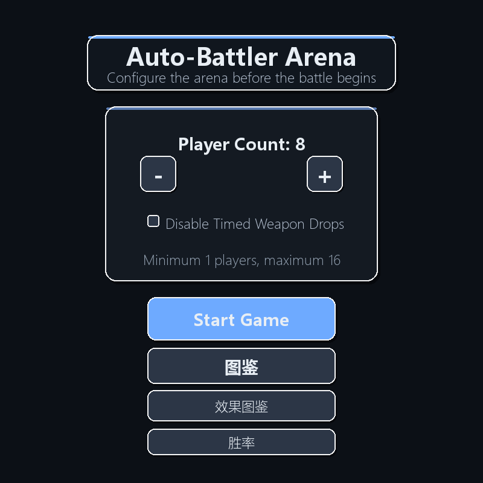
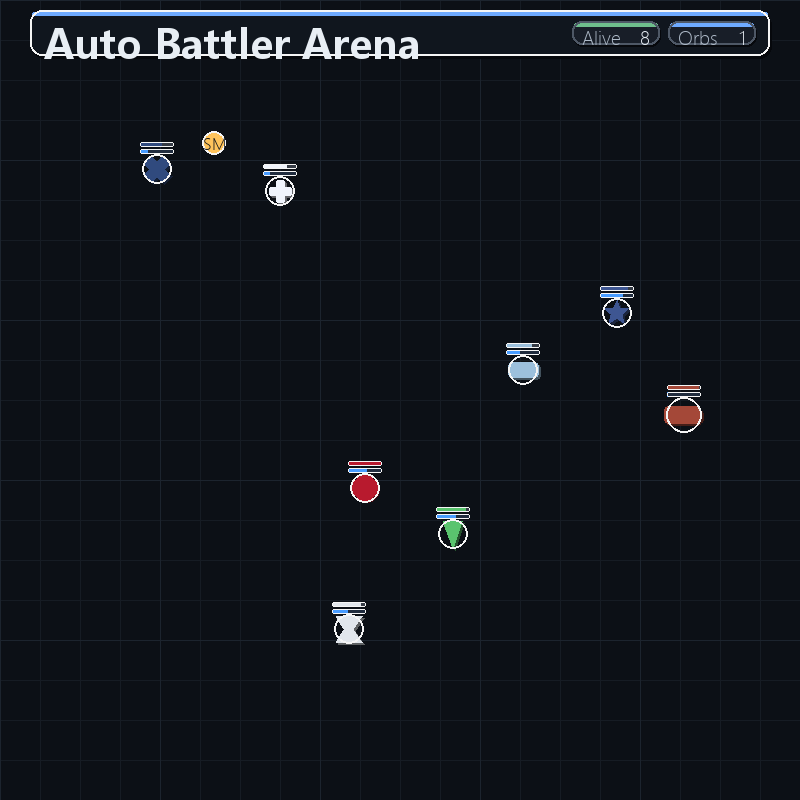
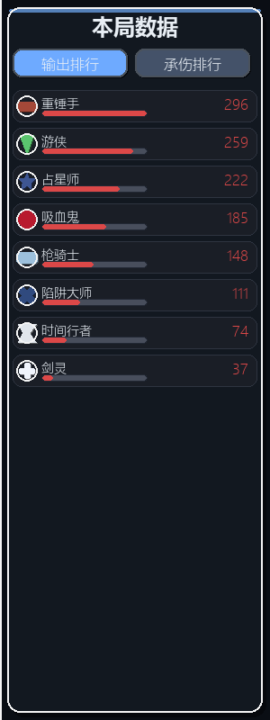
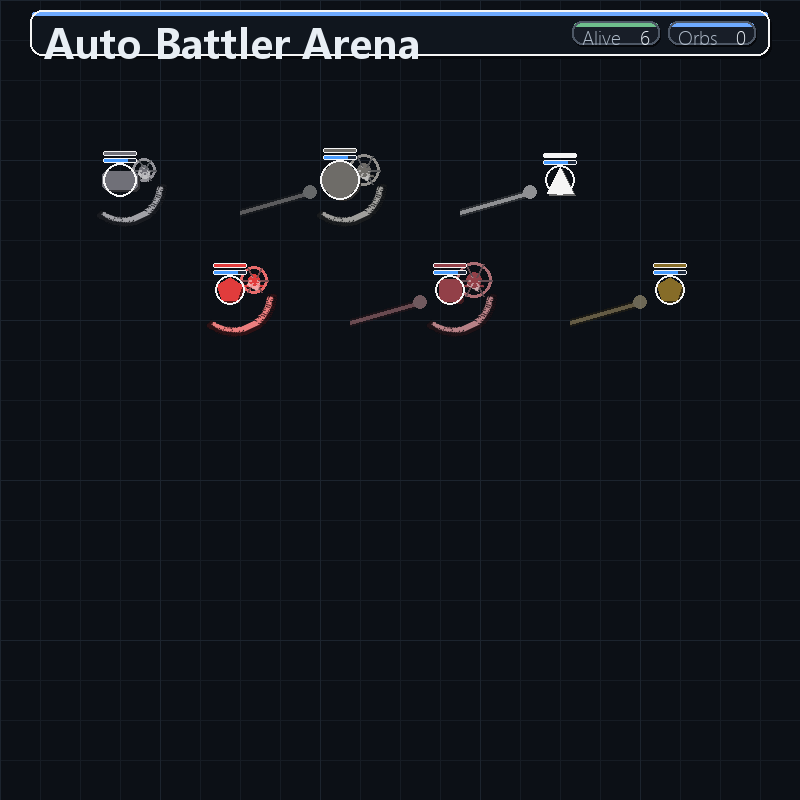
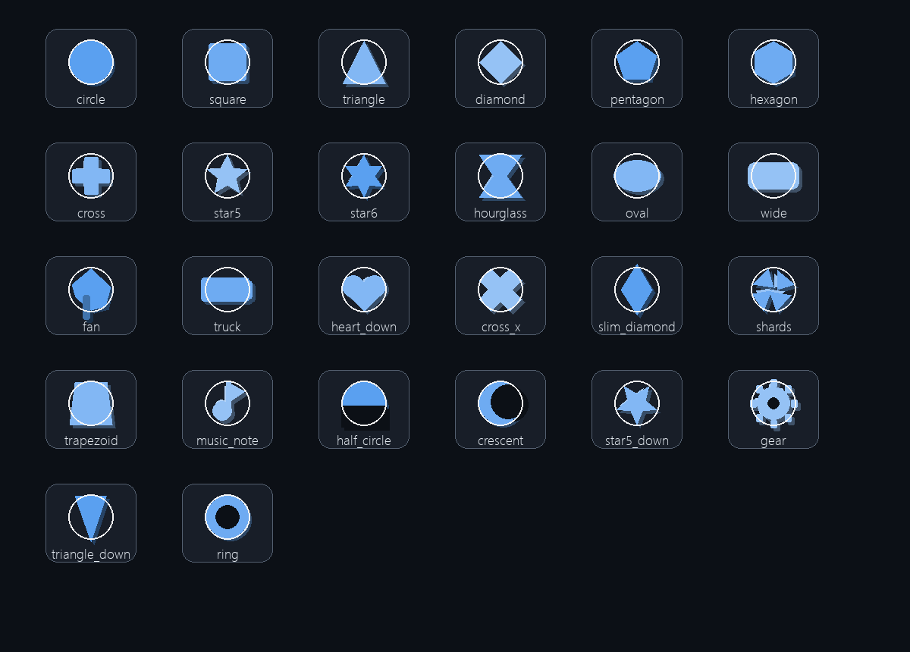

# 圆环斗场 (Circle Arena)

> 一场快节奏、角色各异的 **自动对战竞技场**。132 位能力迥异的战士在圆环中自主寻敌、走位、充能与放大招，直到场上只剩最后一方。你只需坐上观众席，看数值与机制的化学反应。



---

## 📖 项目简介

圆环斗场是一款基于 **Python + Pygame** 的自动战斗（Auto Battler）模拟器。它不要求操作，而把乐趣放在 **角色设计、机制组合与观战演出** 上：每位角色都有独立的普攻节奏、充能方式、被动与主动技能，还会因阵营羁绊、武器拾取、状态叠加而产生意想不到的连锁反应。

项目的核心是一套 **数据驱动的角色系统**：角色写在 Markdown 图鉴里，程序启动时解析成战斗数据；复杂机制（专属技能、特效、资源条）在引擎中以模块化分支实现。加一个角色，通常只需要改图鉴 + 挂一个技能 token。

| | |
|---|---|
| **角色总数** | 132（40 基础 + 92 设计角色）|
| **阵营** | 8（四圣 / 雷神 / 亡灵 / 野兽 / 机械 / 暗影 / 嫉妒 / 遮断）|
| **技术栈** | Python 3.12 · Pygame 2.6 |
| **代码规模** | `game/` 模块化包（约 2 万行）+ 图鉴数据 |

---

## ✨ 特性亮点

### 🎭 132 位角色，机制各不相同
从经典职业（剑圣、刺客、游侠、铁卫）到原创设计角色（须佐之男、狂风灵狐、镇灵判官、玄血武者），每位都有专属普攻逻辑与技能演出。

### 🔗 阵营羁绊
同队同阵营 ≥2 人激活一阶、≥3 人二阶，提供伤害/减伤/攻速/移速加成。
- **四圣**：减伤与输出兼备
- **雷神**：极致攻速
- **亡灵 / 野兽 / 机械 / 暗影**：各有取向
- **嫉妒**：二阶强力减伤
- **遮断**：纯机制阵营（见下）

### ⚡ 遮断体系（边狱巴士式震颤条）
同队 ≥2 名遮断角色登场后，敌人血条下方浮现**金色遮断条**：
- 遮断角色以技能/被动给予目标【遮断】强度与层数
- 每 3 秒结算：遮断条 += 强度、层数 −1（归零状态消散、条保留）
- **遮断条 ≥ 目标当前生命值 → 爆发**：眩晕 5 秒 + 双抗变为 2.5（增伤）后恢复
- **遮断引爆**：令遮断条立刻前移（钉锤工裁决钉击、修筑师击退碰撞等）
- 成员：**129 钉锤工**（钉子/漆黑之神的加护/保存神域）、**130 修筑师**（崩塌反震/坍方顶砸）、**131 重垒壁**（4500 血挨打自充/全场震裂）

### 🧫 玄血体系（132 玄血武者）
玄血武者在场时，全场启用「玄血」第二生命条：
- **未玄成**：受击等量蓄玄血（纯蓄能），伤害全额扣 HP
- **【玄成】**：玄血蓄满后永久标记，此后玄血才参与战斗
- **玄成后**：受击 ×1.5 由 HP 与玄血各承担 50%；玄血武者对玄成目标 80% 形毁（无视防御）、队友附加 10% 形毁；形毁等额消耗玄血
- 玄血武者 HP 归零且玄血未空时**护体保命**；目标受到回复时回复量先等额冲刷玄血

### 🏆 养成与成长
- **98 勇者**：1→10 级成长（每 5 秒/击杀/受击获经验），满级瞬间 +1000 生命、回 30% 血、**外观变金**，普通攻击变双连并附加 50% 真实伤害
- **92 镇灵判官**：击杀叠【拘魂】，受击回复 (0.02% + 0.1×层数) 最大生命

### ⚔️ 死斗模式
红蓝两队擂台对抗，**场上只剩 2 人自动升为 3 倍速**加速决胜。

### 🎛️ 观战体验


- **调速栏**：对战画面左下角 1x / 2x / 3x 一键切换（或按键盘 1/2/3）
- **跟随视角**：侧边栏点角色名即可镜头跟随
- **战斗侧边栏**：输出 / 承伤 / 击杀三榜 + 实时状态面板
  
- **登场演出**：全角色 1.5 秒光柱降临特效
  
  

### 📕 图鉴与数据
- **角色图鉴**：编号排序、搜索、可拖动滚动条、形态专区、战绩联动
- **效果图鉴**：增益/减益状态说明
- **胜率统计**：每局结束写入 `win_rate_stats.json` 并回显在图鉴

---

## 🚀 运行方式

### Windows 一键启动
双击 `LaunchGame.bat` —— 自动检测 Python、缺 pygame 时自动安装、后台启动游戏。

### 手动启动
```bash
pip install pygame
python main.py
```

---

## 🎮 玩法一览

| 模式 | 说明 |
|---|---|
| **混战** | 选择 2~20 人，最后存活者获胜 |
| **擂台/死斗** | 自定义红蓝两队阵容，多对多对抗 |
| **禁用角色** | 最多禁用 3 名角色，随机池会排除它们 |
| **押注** | 开局前可押注某位角色（趣味玩法） |

**快捷操作**

| 按键 | 功能 |
|---|---|
| `1` / `2` / `3` | 1x / 2x / 3x 调速（也可点左下调速栏）|
| `Esc` | 暂停 / 继续 |
| 鼠标滚轮 | 侧边栏滚动 |
| 点击侧边栏角色 | 镜头跟随 |

**菜单选项**

- **关闭定时武器掉落**：默认**常驻开启**（不刷新定时掉落的武器），状态会写入 `settings.json` 跨会话记忆；冷锋枪等插地实体不受影响

---

## 📁 项目结构

```
circle/
├── main.py                 # 入口薄壳（from game import * + main()）
├── game/                   # 游戏逻辑包
│   ├── data.py             #   常量 + 角色/效果数据 + 图鉴/胜率访问
│   ├── character.py        #   Character 角色类（属性/受伤/技能/绘制）
│   ├── engine.py           #   战斗核心（目标选择/特效实体/技能分派/召唤物）
│   ├── ui.py               #   界面绘制（菜单/图鉴/胜率/侧边栏/调速栏）
│   ├── loops.py            #   流程控制（各游戏循环 + main()）
│   ├── world.py            #   世界层（刷怪/场景绘制/状态创建/更新）
│   ├── utils.py            #   纯工具（颜色/几何/文本）
│   ├── drawing.py          #   绘制辅助（形状图标/图鉴详情面板）
│   ├── runtime.py          #   跨模块共享可变全局
│   └── paths.py            #   项目根路径锚点
├── design_characters.py    # 从 sheding/charactor.md 解析设计角色的生成器
├── tests/regress.py        # headless 回归测试（数据完整性 + 死斗模拟 + 渲染冒烟）
├── LaunchGame.bat          # Windows 一键启动脚本
├── win_rate_stats.json     # 各角色胜率统计（对局后自动更新）
├── settings.json           # 玩家设置（音量/画质/跳过登场/关闭定时掉落）
├── sheding/
│   ├── charactor.md        # 设计角色图鉴数据（改它 = 加角色）
│   └── 角色模板.md          # 新增角色的填写模板
├── bug/                    # 崩溃报告归档（crash_*.txt）
└── *_preview.png           # 菜单/战斗/特效/侧边栏预览图
```

### 形状一览

所有角色的外形由 `drawing.py` 的形状库绘制（约 40 种），并支持随朝向旋转：



---

## 🧭 加一个新角色

1. **写图鉴**：在 `sheding/charactor.md` 末尾按 `角色模板.md` 格式追加角色块（编号 + 中文名 + 英文名 + 属性 + 技能描述）
2. **挂配置**：在 `design_characters.py` 的 `ROLE_CONFIG_OVERRIDES` 中为该编号指定 `skill_token`、充能方式、普攻类型等
3. **实现机制**：
   - 主动技能 → `game/engine.py` 的 `cast_design_skill` 加分支
   - 角色被动 / 状态 / 绘制 → `game/character.py`
   - 新常量与数值 → `game/data.py`
   - 全新外形 → `game/drawing.py` 的 `draw_shape_icon` + `VISUAL_SHAPE_MAP`

> 例：遮断阵营的实现横跨 `data.py`（常量/阵营）、`world.py`（每 3 秒结算 + 遮断条门控）、`character.py`（字段/入口）、`engine.py`（引爆/技能）。

---

## 🧪 回归测试

```bash
python tests/regress.py            # 默认：数据完整性 + 20 人死斗 2400 帧 + 单帧渲染冒烟
python tests/regress.py 1200 12    # 自定义帧数 / 人数
```

**通过标准**

```
[data] JOB_DEFS=132 CHARACTER_DATA=132 RESIST=132 OK
[sim] 2400 帧后存活 N 人（阵亡 M），结果: ...
[render] 单帧渲染 OK
ALL PASS
```

---

## 🛠️ 机制速查（部分角色）

| 角色 | 机制 |
|---|---|
| 狂风灵狐 | 气层双刃、命中附加 0.5% 最大生命真伤 |
| 绝影枪客 | 掷枪、短距突刺、专属武器「冷锋枪」实体 |
| 聚光使 | 普攻激光滋人、贯穿激光全场引导 |
| 钉锤工 | 钉子、漆黑之神的加护、保存神域（群体护盾/减伤）|
| 修筑师 | 崩塌反震（引爆真伤）、坍方顶砸（击退碰撞引爆）|
| 重垒壁 | 挨打自充遮断、不破壁垒护盾、全场震裂 |
| 玄血武者 | 玄血第二生命、玄成、形毁斩杀 |
| 镇灵判官 | 魂链护盾、斩杀、巡狩召唤、拘魂回血 |
| 勇者 | 1→10 级成长、满级金色变身 + 普攻双连真伤 |
| 榴弹炮手 | 饱和打击 10 枚迫击炮弹 |
| 唤雨师 | 全场斜雨 + 溅水花特效 |
| 座敷童子 | 鬼火资源、宅内厄除 / 福运昌隆 |

---

## 📄 许可与说明

- 本项目为个人练习与兴趣作品，角色/机制均为原创或通用幻想设定。
- 崩溃时自动在 `bug/` 生成 `crash_*.txt`（含完整 traceback），欢迎据此提 issue。
- 部分机制数值会持续平衡调整，以 `game/data.py` 与 `sheding/charactor.md` 为准。
